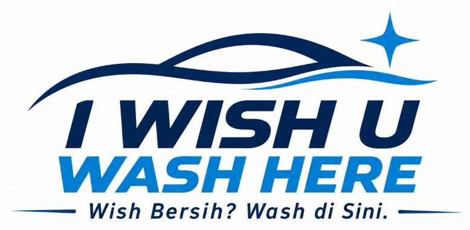

<p align="center">
  
</p>

# I wish U wash here — Cuci Mobil Terjadwal & Carwash Membership (Banda Aceh)

> **Tagline:** *Wish Bersih? Wash di Sini.*

Aplikasi web modern berbasis **Vite + React + TypeScript + Tailwind CSS** untuk layanan cuci mobil terjadwal, sistem antrean prioritas, dan membership bulanan di **Banda Aceh**. Dilengkapi persistensi data otomatis menggunakan **React Context + `localStorage`** (dengan tombol **Reset Data Demo** di halaman Admin) serta siap langsung di-deploy ke **Vercel**.

---

## Fitur Utama

### 1. Beranda (`/`)
- Hero section dengan informasi layanan & Kartu Digital Member VIP.
- **Kalkulator Hemat Interaktif**: geser slider frekuensi cuci per bulan (1–12x) untuk membandingkan biaya cuci satuan (Rp 50.000/cuci) vs paket membership.
- Kartu & tabel perbandingan paket (**Bronze**, **Silver**, **Gold**) dengan tombol pilih paket langsung ke halaman pendaftaran.

### 2. Membership (`/membership`)
- **Daftar Membership Baru (Create)**: pilih tier Bronze/Silver/Gold, otomatis generate `memberCode` (`CRK-YYYY-XXX`), kuota bulanan, poin awal, dan masa aktif 30 hari.
- **Cek Kartu Member Digital (Read)**: cari berdasarkan Kode Member atau Plat Nomor untuk melihat sisa kuota, poin loyalitas, status aktif, dan masa berlaku.
- **Kelola Membership (Update)**: perpanjang masa aktif (`+30 Hari & +50 Poin Loyalitas`) dan upgrade tier langsung dari kartu digital.

### 3. Booking Jadwal Cuci (`/bookings`)
- **Mode Member & Non-Member (Create)**:
  - Mode Member otomatis memvalidasi status `ACTIVE`, sisa kuota `> 0`, serta kebijakan batas wajar paket **Gold** (maks. 1x cuci per hari pada tanggal yang sama).
  - Prioritas antrean otomatis disesuaikan berdasarkan tier (`Gold > Silver > Bronze/Reguler`).
- **Antrean Hari Ini & Pelacakan (Read)**: daftar antrean hari ini terurut prioritas dan pencarian riwayat berdasarkan Kode Booking / Plat Nomor.
- **Reschedule & Batalkan (Update)**: pelanggan dapat menjadwal ulang tanggal/jam atau membatalkan booking selama status masih `PENDING` atau `CONFIRMED`.

### 4. Pusat Komplain (`/complaints`)
- **Pengajuan Komplain (Create)**: pilih kategori, tingkat urgensi (`LOW`, `MEDIUM`, `HIGH`), kronologi masalah, serta upload preview foto bukti (`FileReader` base64).
- **Lacak Tiket (Read)**: cari berdasarkan Nomor Tiket (`CMP-YYYY-XXX`) atau No. HP untuk melihat progres dan catatan resolusi admin.
- **Tambah Detail / Batalkan (Update)**: pelanggan dapat menambahkan keterangan atau membatalkan tiket selama status masih `OPEN`.

### 5. Dashboard Admin CRUD (`/admin`)
- Ringkasan KPI: **Total Member Aktif**, **Estimasi MRR Bulanan**, **Booking Hari Ini**, dan **Komplain Terbuka**, ditambah tombol **Reset Data Demo**.
- Manajemen CRUD lengkap dengan pencarian, filter status, modal Tambah/Edit, dan konfirmasi Hapus pada 4 tab:
  - **Bookings**: urutan prioritas otomatis, ubah status (`PENDING` → `CONFIRMED` → `IN_PROGRESS` → `COMPLETED` / `CANCELLED`) dengan pemotongan & pengembalian kuota member otomatis.
  - **Memberships**: tambah/edit member, ubah tier/kuota/status, perpanjang masa aktif, hapus member.
  - **Complaints**: lihat bukti foto, ubah status, wajib isi catatan resolusi/kompensasi saat menyelesaikan tiket, hapus tiket.
  - **Service Packages**: tambah/edit paket, atur harga/kuota/fitur, aktif/nonaktifkan paket, hapus paket.

---

## Tech Stack

- **Frontend:** React 18, TypeScript, Vite 6
- **Styling:** Tailwind CSS 3, Lucide React Icons
- **Routing:** React Router DOM v6
- **State & Storage:** React Context API + `localStorage`
- **Deployment:** Vercel (dilengkapi `vercel.json` SPA rewrite)

---

## Struktur Folder

```text
├── public/
│   └── logo.png              # Logo resmi I wish U wash here
├── src/
│   ├── components/           # Navbar, Footer, Modal, StatusBadges, ToastContainer
│   ├── context/              # CarakateContext (store & aturan bisnis), ToastContext
│   ├── data/                 # seedData.ts (data demo realistis Banda Aceh)
│   ├── pages/                # HomePage, MembershipPage, BookingsPage, ComplaintsPage, AdminPage
│   ├── types/                # carakate.ts (skema TypeScript)
│   ├── utils/                # format.ts (format Rupiah, tanggal, label status)
│   ├── App.tsx
│   ├── main.tsx
│   └── index.css
├── index.html
├── vercel.json               # Konfigurasi SPA rewrite untuk Vercel
└── package.json
```

---

## Data Demo Bawaan

Anda dapat langsung mencoba fitur pelacakan dengan data demo berikut:
- **Kode Member:** `CRK-2026-001` (Gold), `CRK-2026-002` (Silver), `CRK-2026-003` (Bronze), `CRK-2026-004` (Silver)
- **Kode Booking:** `BK-2611-01` s/d `BK-2611-05`
- **Nomor Tiket Komplain:** `CMP-2026-001`, `CMP-2026-002`, `CMP-2026-003`

---

## Menjalankan Secara Lokal

```bash
# 1. Install dependencies
npm install

# 2. Jalankan development server
npm run dev

# 3. Build produksi (cek TypeScript + Vite build)
npm run build
```

Buka `http://localhost:5173/` di browser Anda.

---

## Deploy ke Vercel

1. Impor repository ini di [Vercel](https://vercel.com/new).
2. Pilih Framework Preset **Vite** (`npm run build`, output `dist`).
3. Klik **Deploy** — file `vercel.json` sudah dikonfigurasi agar refresh di semua route SPA tidak menghasilkan error 404.
